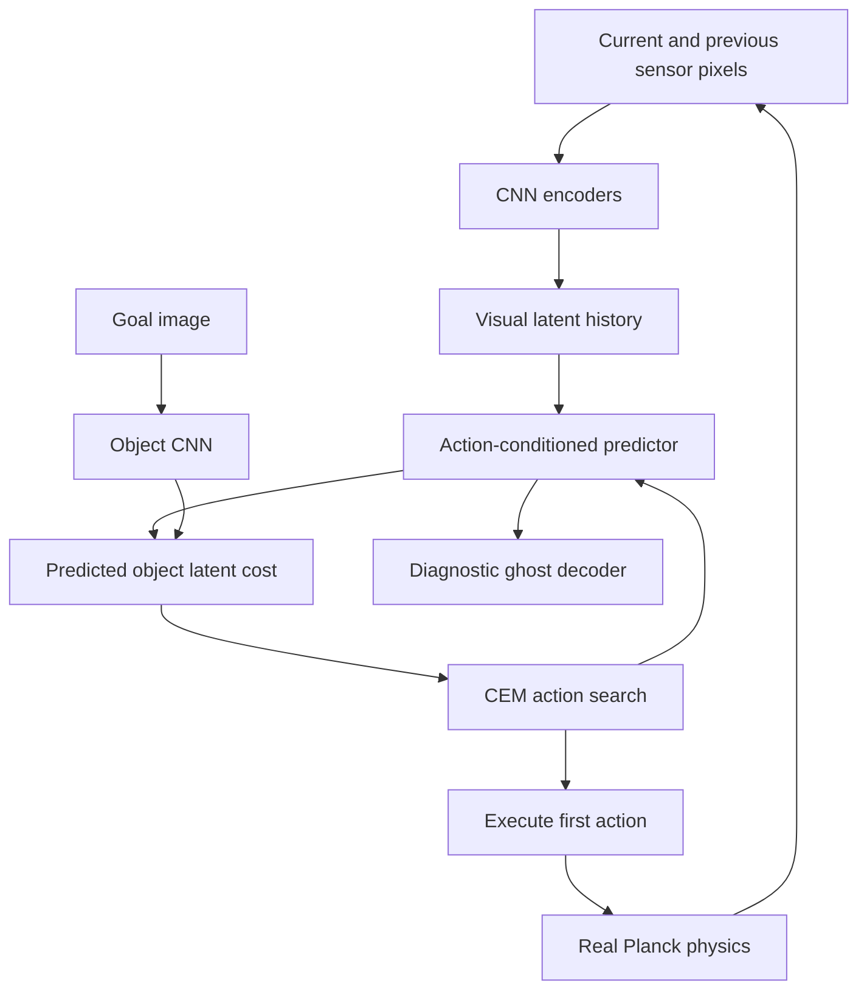

# Tiny World Planner

A small, **experimental** image-conditioned world model for a PushT-inspired task. The browser encodes pixels, recursively predicts latent futures under actions, searches with CEM and executes the first action in real Planck contact physics. No server inference, WebGPU, policy fallback, cloned physics rollouts or scripted success animations are used.

**This is not V-JEPA 2 or DINO-WM, and it is not a reliable manipulation controller.** Representation training starts with VICReg. Frozen-feature probes failed the required pose-quality gates, so the released experiment uses explicitly disclosed auxiliary pose regression **and pairwise pose-metric supervision**. It must not be described as purely self-supervised or as a reproduction of either paper. The action-conditioned predictor still learns transitions between visual embeddings; CEM compares predicted object embeddings with an encoded goal image. The diagnostic pose decoder never contributes to action selection.

## Run

Open [/tiny-world-planner/](https://leonardo-maglanoc.com/tiny-world-planner/). Drag the green target and rotate it with the slider. Use **Plan & execute**, or enable **Inspect plan** and advance one action at a time. **Disturb reality** enables object/pusher dragging. Arrow keys provide manual pusher control. Reset replays the same seed; New scene advances the seed. Challenge goals are allowed to fail.

The orange T and blue pusher are real simulation. Violet ghosts are **diagnostic decodings of neural latent predictions**, not predicted RGB frames or future physics rollouts. Actual geometric coverage is separate from the latent planning cost. Success requires real overlap ≥95% for three consecutive action intervals; every preset is evaluated on its actual outcome.

## Architecture and boundaries



`src/planner.js` imports no simulator, rasterizer or decoder. Its inputs are latent state, goal embedding, a learned inference interface and a seeded random generator. The Worker receives only image-derived masks and compute/reset flags. It computes CEM cost **before** invoking the diagnostic decoder. Ground-truth poses are used to render the sensor, collect auxiliary training labels, measure overlap and draw reality; they are never sent to the planner. The goal pose is used only to render its image and evaluate real overlap.

`physics.js`, `raster.js` and `observation.js` are shared by Node collection, browser execution and tests. There is no Python physics implementation. Node/browser replay is checked within 1e-10, allowing floating-point differences across V8 builds; repeated replay in one runtime is exact.

## Environment and sensor

This is a controlled-domain task, **not the original PushT benchmark**. Coordinates are world units, x rightward and y downward, in a 10×10 workspace. The T consists of non-overlapping local rectangles `[-1.2,-1.05,1.2,-.4]` and `[-.325,-.4,.325,1.05]`, total area 2.5025. The pusher radius is .23. Gravity is zero; the block has density 1, friction .35, restitution 0, and linear/angular damping 6. Walls have friction .3. The kinematic pusher uses a velocity target with friction .25. Kinematic wall limits are clamped explicitly.

An action in `[-1,1]²` is a relative displacement of at most .48 units per axis, tracked across 12 substeps of 1/120 s. The action interval is exactly 100 ms. Physics **holds during planning**, while animation/UI remain responsive. The maximum episode budget is 100 planned actions. Relative actions intentionally differ from original PushT absolute-position commands.

The sensor rasterizes a 64×64 RGBA image with 2×2 subpixel samples. Pixel preprocessing unmixes the distinctive object/pusher colors into soft silhouette masks, quantized to 1/255. It reads colors, not body transforms. Subpixel coverage replaces the initial hard silhouettes, which discarded useful precision. The goal sensor uses the same solid T appearance and no pusher; green UI outlines and ghost objects never enter observations. Masks are not spatially cropped or centered: absolute image position must be retained. This assumption is specific to the rendered domain and does not imply real-world perception robustness.

## Networks and learning

Each single-frame encoder uses convolution stages 8/16/16 with strides 2, a retained 8×8 spatial grid, a 64-unit projection and a 16-D object or 8-D agent output. Features are normalized with training-only mean/std. The dynamics state concatenates current 24-D features and previous 24-D features. This separates a stationary **goal appearance** from temporal history. No goal-motion embedding is imposed.

The predictor is a residual MLP, input 50, hidden 192/192, predicting the next 24-D feature vector; the previous half of the next state is shifted explicitly. A separate 24→96→96→6 decoder predicts normalized object xy, sin/cos angle and pusher xy for diagnostics only. Export uses ONNX opset 17 and dynamic batch axes.

Stage A uses two noise-augmented views and VICReg invariance, variance and covariance terms, with no geometric invariance augmentations. Frozen linear probes assess position and angle on validation episodes. On failure, auxiliary pose regression and pose-distance metric regularization organize the visual features. Stage B freezes the encoders, caches features and trains 1-, then 3-, then 5-step recurrent predictions. Half the batches oversample real contact transitions. The best checkpoint is selected using held-out validation five-step error. A diagnostic MLP is then fitted on frozen training latents. Test episodes are excluded from fitting and checkpoint selection.

Data collection mixes smooth random actions, near-object waypoints, directed waypoints and mixed interactions. It contains failures and non-contact trajectories, not just successful demonstrations. Episodes use seeds 10000 onward, collector RNG 20261114; training uses seed 714. Splits are by whole episode: 80/10/10. Contact labels are true pusher/block touching during any physics substep; meaningful movement means object translation >.01 units in an action. Compressed image/state/action/contact shards and PyTorch checkpoints are excluded from Git.

## CEM and runtime

Light mode uses 32 candidates, horizon 6, three iterations; Standard uses 64 candidates, horizon 8, three iterations. Elite count is 15%, minimum 4. Costs are object-latent terminal MSE, intermediate MSE with total weight .2, action magnitude penalty .0005 and action-smoothness penalty .0005. The goal embedding is cached. The previous plan is shifted as a warm start. Candidates mix temporally correlated and independent perturbations; explicit no-op/mean candidates are included. Every rollout step is **one batched ONNX call**, never one call per candidate.

Inference runs in one dedicated Worker with ONNX Runtime Web **1.21.0**, reusing the site's pinned `doom/vendor/ort` assets, one WASM thread and no GPU execution provider. The UI keeps at most one pending plan. Versioned results invalidate stale plans after edits, resets and disturbances. Non-finite outputs or a 15-second watchdog cause a visible failure and no action. Inference failures never invoke a hidden controller.

## Measured results

See [training.json](results/training.json), [planning-lite.json](results/planning-lite.json), [wasm-parity.json](results/wasm-parity.json), [browser.json](results/browser.json) and [state-baseline.json](results/state-baseline.json). `RESULTS.md` summarizes the released measurements and success gate. Earlier negative experiments are retained under `results/experiment-v1` and `results/experiment-v2`. Browser and Node timing are distinguished; mobile emulation is not a physical Android benchmark.


## Reproduce with Docker

From repository root:

```sh
docker compose -f tools/tiny-world-planner/compose.yml run --build --rm train
docker compose -f tools/tiny-world-planner/compose.yml run --build --rm validate
```

Training/export runs in the `train` target. Validation runs physics tests, CPU/WASM parity and Chromium interaction tests at desktop 1440×1000, portrait 393×852 and landscape 852×393. GitHub Actions builds and runs the validation image, retaining browser results and screenshots. No daemon is assumed inside the browser demo.

Equivalent local commands, from `tools/tiny-world-planner`:

```sh
npm ci
python -m pip install -r requirements.txt
node generate.mjs 700 80 local-data
python -u train/train.py > results/training.log 2>&1
python eval/baseline.py
node eval/parity.mjs
npm test
node eval/planning.mjs 50 100 lite
node eval/browser.mjs
python eval/summarize.py
```

`CHROME_BIN` can select an installed Chrome/Chromium binary; otherwise Playwright's bundled Chromium is used. The browser test starts its own static server. Large outputs remain local. Browser release files are only under `assets/interactive/tiny-world-planner`; training tools are excluded by the site's Jekyll configuration.

## Evaluation and limitations

Final planning uses separately reserved seeds, identical across random actions and neural MPC, with 100 actions per task and 50 seeds per difficulty. Random-action baseline receives no privileged control. The optional numerical-state learned baseline is explicitly privileged, evaluated offline, and is not exported. Prediction metrics cover 1/3/5/8-step latent error, standard deviation, decoded xy/orientation error and true contact/non-contact subsets. The constant-state baseline predicts unchanged current features. An action-sensitivity measurement checks that opposite actions change predictions.

The release gate is ≥50% easy success and ≥2× random success, plus genuine image-only planning. A missed gate means **experimental**, never a fabricated pass. Poorly calibrated latents can lead to incorrect ghost motion; contact predictions are harder than non-contact transitions. CEM may exploit model error, miss contact, become stuck or lose alignment near a goal. Decoder error and dynamics error both contribute to ghost mismatch. Disturbance recovery is possible but not guaranteed. No uncertainty guarantee, safety guarantee, zero-shot transfer or physical-robot claim is made.

## Relation to the research

- [V-JEPA 2 / V-JEPA 2-AC](https://arxiv.org/abs/2506.09985) uses large-scale video pretraining and an action-conditioned extension for planning. This tiny task-specific CNN is not its architecture or pretrained model.
- [DINO-WM](https://arxiv.org/abs/2411.04983) predicts pretrained DINOv2 spatial patch features and plans toward observational goals. This demo shares latent goal-image MPC, but learns small task-specific embeddings instead of using DINOv2.
- [VICReg](https://arxiv.org/abs/2105.04906) motivates the non-collapse representation objective. Pose-metric supervision in this release is an additional disclosed design choice.
- [DreamerV3](https://arxiv.org/abs/2301.04104) learns behavior inside a world model; this demo instead optimizes action sequences online at every observation. The existing site's TinyDreamer remains independent.
- [Original PushT implementation](https://github.com/real-stanford/diffusion_policy/tree/main/diffusion_policy/env/pusht) inspires the geometry and overlap idea; physics, sensor and action interfaces here differ.
- [Planck](https://github.com/piqnt/planck.js) supplies contact physics. [ONNX Runtime Web](https://onnxruntime.ai/docs/tutorials/web/) supplies browser inference.
