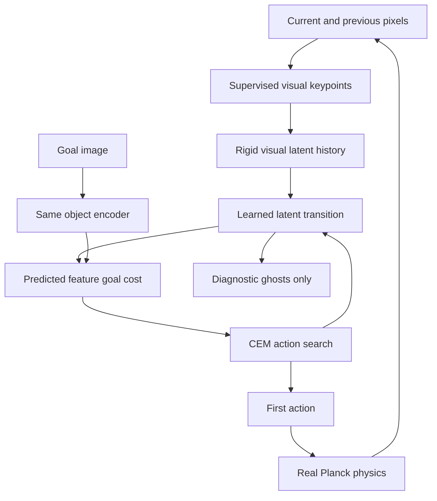
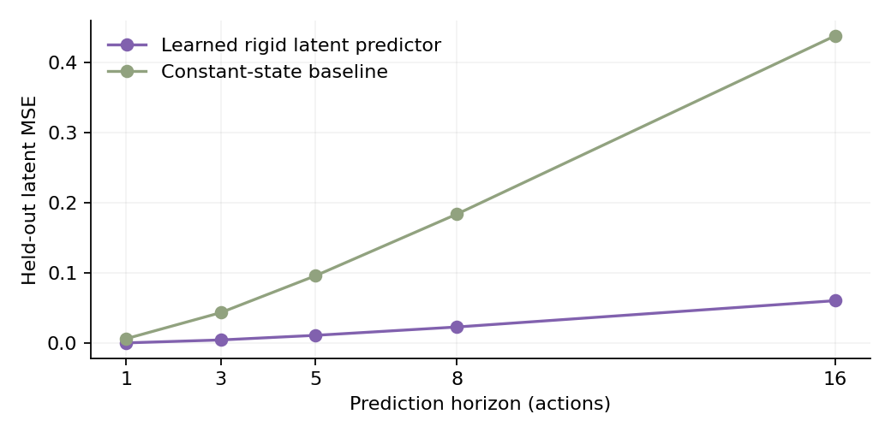

# Tiny World Planner

An **experimental image-conditioned world-model MPC demo**, running locally in a static browser page on CPU/WASM. Images are encoded into learned visual features; an action-conditioned neural predictor imagines candidate futures; CEM chooses an action, real Planck contact physics executes it, and new images trigger replanning.

**The reliability target is not met.** The updated reserved benchmark has **3/50 easy successes**, versus 0/50 random actions. The default example genuinely succeeds through fresh neural planning, but arbitrary goal edits, rotations and disturbances often fail. See [measured results](results/RESULTS.md) and raw [planning episodes](results/planning-lite.json).

**Scientific disclosure:** the original VICReg representation/dynamics implementation achieved no strict easy successes. The current release is an explicitly **pose-supervised visual-keypoint fallback with geometric priors**, not purely self-supervised learning, V-JEPA 2, DINO-WM, or a foundation model. The goal is still supplied only as pixels; no true pose, velocity, contact state, goal coordinates or physics rollout enters deployed action selection.

## Interaction

Open [Tiny World Planner](https://leonardo-maglanoc.com/tiny-world-planner/). Drag/rotate the green target. Run, pause, inspect a plan, execute one action, reset, or disturb the orange block/blue pusher. Arrow keys move the pusher manually. Phone touch dragging is supported.

The initial seed **902005** is a selected development example, excluded from training and the reserved benchmark. It demonstrates a successful closed-loop neural execution in 14 actions. It is **not** a replay: resetting recomputes every prediction and action, and moving the target changes the problem. New scene advances the seed; success is not guaranteed.

Reality is drawn in orange/blue. Green is the goal. Violet ghosts are a **separately fitted diagnostic decoder's interpretation of predicted latents**, not generated RGB frames or simulated future rollouts. Only actual geometric overlap can trigger the success display: ≥95% for three consecutive action intervals.

## Architecture and isolation



`src/planner.js` imports no physics, sensor renderer or pose decoder. The Worker receives masks, reset/version flags and compute settings. It scores neural latent predictions before calling the diagnostic head. Simulator state is used separately to render pixels, collect supervised perception labels, draw reality and measure overlap. The goal pose is used to render its image and evaluate outcomes, never to compute CEM costs.

Privileged oracle and exact-keypoint ablations exist **only under tools/eval**, clearly labeled offline diagnostics. They are never imported into the website, and their actions never replace neural planning. An online image-residual experiment was also tested; it did not improve the strict success rate and is **not deployed**.

## Physics and observation

The exact same `physics.js`, `raster.js` and `observation.js` are imported by Node generation, browser execution and tests. There is no Python simulator. Same-runtime seeded replay is exact; Node/Chrome replay is checked within 1e-10.

This is **PushT-inspired, not the original benchmark**. The workspace is 10×10 units, x right/y down, zero gravity. The T combines rectangles `[-1.2,-1.05,1.2,-.4]` and `[-.325,-.4,.325,1.05]` with total area 2.5025. Density is 1; block friction .35, restitution 0, linear/angular damping 6. The circular kinematic pusher has radius .23 and friction .25. Wall friction is .3; pusher workspace limits are clamped explicitly.

Actions are bounded relative displacements in `[-1,1]²`, scaled by .48 units/axis, tracked with a velocity target over 12 substeps of 1/120 s. The action interval is 100 ms and the budget 100 actions. Physics holds during planning while rendering/UI remain responsive. This relative-action interface intentionally differs from original PushT's absolute positions.

A shared deterministic rasterizer makes 64×64 RGBA images with 2×2 subpixel sampling. Color unmixing derives object/pusher soft masks from pixels, quantized to 1/255. It never reads transforms. No cropping, centering or geometric invariance augmentation removes absolute image position. Goal encoder input uses the same solid object appearance, excludes the pusher, and never includes green outlines/ghosts. These color/domain assumptions do not imply real-world perception robustness.

## Learned representation and dynamics

The object CNN predicts four spatial-softmax feature points. Supervised Gaussian heatmap and coordinate losses use pose-derived keypoint labels during offline training. A differentiable rigid projection removes inconsistent changes in the feature constellation's shape. The agent CNN predicts one feature point. This is **fully supervised perception**, following failed self-supervised development experiments, and is disclosed in model metadata and the UI.

The 8 object coordinates are repeated twice /√2 into 16 dimensions; the 2 agent coordinates are repeated four times /2 into 8 dimensions. The repeated dimensions preserve the existing browser interface; they must not be interpreted as 24 independent state factors. Current and previous features form the 48-D dynamics input. Single-frame goal features are compared only with the predicted object features, independently of motion history/pusher position.

The predictor expresses image-derived geometry in the learned keypoints' local frame. A 21→192→192→192→4 ReLU MLP learns object translation, rotation and motion gating. The rigid transform parameterization and a rest-preserving gate are explicit geometric priors; **all contact-induced motion is learned from trajectories**. A learned 2×2 action matrix predicts pusher movement with fixed workspace bounds. No candidate contacts, forces or future states are obtained from Planck. A separately fitted 24→6 ridge-linear diagnostic head predicts object xy/sin/cos and pusher xy solely for visualization/evaluation.

The original model and negative results remain in Git history and `results/original-release/`. The new encoder was fitted on 700×80 trajectories. Dynamics training adds 1,400×60 mixed trajectories: half the episodes start near different object faces and use small varied actions, improving coverage of precise pushing; the other half retain broad exploration. True contact occurs in about 39% of this dynamics dataset. Dataset policies use state only during offline collection, not deployment, and do not optimize final evaluation goals.

Training splits by entire episode (80/10/10). Encoder seeds are 731; dynamics seed 733. Original collection starts at seed 10000, precision collection at 120000. Frozen encoders produce dynamics targets; the predictor is trained recursively over 1/3/5 steps with contact oversampling and validation checkpoint selection. The final reserved planning seeds 930000–930049 are disjoint from training and development seeds. Prediction split metrics were inspected during development and should not be treated as a preregistered test of every architecture choice.

## Planning and performance

Light mode uses horizon 8, 128 candidates, six CEM iterations and four piecewise-constant action knots. Standard uses horizon 8, 256 candidates and eight iterations. Elites are 10% (minimum six). Each iteration keeps 20% broad exploration candidates, plus explicit mean/no-op candidates; fitted standard deviation has floor .025. Previous actions initialize a shifted warm start.

Cost is terminal object-feature MSE plus intermediate costs of total weight .05 and action regularization .00002. The visual goal embedding is cached. When **observed learned feature MSE** is below .0004, a documented visual-hold branch executes no-op actions and still predicts their futures with the neural model. This uses no ground-truth success metric; actual overlap is measured separately. The threshold was selected on development examples, not reserved benchmark seeds.

All candidates use one **batched** neural call per imagined timestep. One Worker runs ONNX Runtime Web 1.21.0 with one WASM thread and no GPU provider, reusing the site's vendored runtime. Tensor outputs/inputs are disposed. At most one pending plan is queued; versioned responses invalidate stale results. Nonfinite predictions, bad costs or a 15-second watchdog cause a visible failure and no execution. There is no hidden fallback solver.

Browser tests verify desktop 1440×1000, phone portrait 393×852 and landscape 852×393; touch dragging, goal rotation, default real neural success, inspect/step, pause, reset, parity and replay. Mobile viewports are **emulation**, not physical Android performance. See `browser.json`, Docker CI artifacts and the deployment validation record. Model downloads are local static assets, not network inference.

## Results and limitations

See [RESULTS.md](results/RESULTS.md), [training metrics](results/training.json), [episode outcomes](results/planning-lite.json), and [WASM parity](results/wasm-parity.json). PyTorch/native ONNX and browser WASM checks cover batches 1/64 and five-step recursion with error target <1e-4.



The current model demonstrates real successes, but misses the ≥50% easy reliability target. It can approach a goal and fail the last few percent, miss/lose contact, become trapped, exploit prediction error, or fail after disturbance. Longer searches sometimes perform worse as model error accumulates. Increasing compute is not a guarantee of better behavior. Higher final coverage is **not** counted as success unless the strict overlap criterion is met.

A privileged offline physics diagnostic solved three development cases after search was improved; this only establishes a diagnostic reference, not neural performance. New-model planning and random baselines use identical reserved seeds; the original controller was also evaluated on the new easy seeds for a paired comparison. Raw outcomes and negative experiments are retained.

## Reproduce

From repository root:

```sh
docker compose -f tools/tiny-world-planner/compose.yml run --build --rm train
docker compose -f tools/tiny-world-planner/compose.yml run --build --rm validate
```

The training target runs `reproduce_keypoints.sh`, preserving the actual sequence of supervised encoders and structured dynamics refinements. Its temporary datasets/checkpoints remain excluded from Git and Docker build contexts. The validation target runs unit checks, ONNX/WASM parity and Chromium interactions. GitHub Actions executes this Docker validation independently of local Docker availability.

Equivalent local commands, from `tools/tiny-world-planner`:

```sh
npm ci
python -m pip install -r requirements.txt
sh reproduce_keypoints.sh
node eval/planning.mjs 50 100 lite
python eval/evaluate_keypoints.py
node --test tests/*.test.mjs
node eval/browser.mjs
```

`CHROME_BIN` selects an installed Chrome/Chromium binary; otherwise Playwright's bundled Chromium is used. Export uses ONNX opset 17, FP32 and dynamic batch axes. Metadata records image/action timing and normalization, architecture, dataset versions, checkpoint/model hashes, benchmark seeds and measured metrics. Jekyll excludes tools; only browser runtime assets and compact ONNX models are published.

## Research context

- [DINO-WM](https://arxiv.org/abs/2411.04983) predicts pretrained DINOv2 spatial patch features and optimizes toward image goals. This demo shares latent image-goal MPC, but uses a small supervised spatial bottleneck rather than pretrained DINOv2 features.
- [V-JEPA 2 / V-JEPA 2-AC](https://arxiv.org/abs/2506.09985) motivates action-conditioned feature prediction and planning. This demo reproduces neither its architecture, pretraining nor results.
- [VICReg](https://arxiv.org/abs/2105.04906) motivated the initial representation experiment, which failed the required pose-quality/planning gates.
- [Deep Spatial Autoencoders](https://arxiv.org/abs/1509.06113) provides context for learned spatial feature points; this release's explicit keypoint supervision is a different training choice.
- [DreamerV3](https://arxiv.org/abs/2301.04104) learns behavior within a world model. Here actions are optimized online at each observation; the site's TinyDreamer remains independent.
- [Original PushT](https://github.com/real-stanford/diffusion_policy/tree/main/diffusion_policy/env/pusht), [Planck](https://github.com/piqnt/planck.js), and [ONNX Runtime Web](https://onnxruntime.ai/docs/tutorials/web/) supply task inspiration and runtime context.
